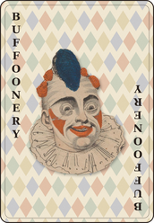

[](https://crates.io/crates/buffoonery)
[](https://github.com/ImperialBower/buffoonery/actions/workflows/ci.yaml)
[](CODE_OF_CONDUCT.md)
[](LICENSE-APACHE)
[](AI-BOM.md)

---

# buffoonery



Foundation for a Balatro-style score calculator to help learn optimized play
and math. It models jokers, editions, boards and scoring on top of [cardpack](https://crates.io/crates/cardpack),
and it is growing a step-by-step score trace, boards you can write as YAML,
and a WebAssembly (WIT) component so other programs, like a joker calculator
in the browser, can use it. The engine started life as cardpack's `funky`
feature.

## How to use

```shell
git clone https://github.com/ImperialBower/buffoonery.git
cd buffoonery
make setup
make ayce
```

`make ayce` runs the whole quality gate. `make help` lists every target.

`make setup` runs once. It needs rustup and Node (versions in
`.tool-versions`). It adds the `wasm32-wasip2` target, installs
`cargo-deny` and `cargo-audit`, installs the npm packages, and installs
Chromium for the browser tests. On Linux, Chromium's system libraries need
sudo. The devcontainer runs it for you.

## WebAssembly component

[`component/`](component/README.md) wraps the engine in a WIT interface:
score a board written as JSON or YAML, get the step-by-step trace back as
JSON. The optimized component is 488 KiB (175 KiB gzipped); the budget is
500 KiB.

## Joker Calculator

[`web/`](web/) is a Balatro joker calculator built on the component: pick a
hand, slot in jokers, override or debuff them, and read the score step by
step. It does no scoring of its own.

```shell
make web                 # builds the component, tests the page, builds web/dist
make dev                 # serves it with live reload
make e2e                 # opens every golden fixture in Chromium and checks the table
```

## What's in the box

- **Formatting:** rustfmt — see [toolchain decisions](.okf/decisions/toolchain.md)
- **Linting:** clippy at pedantic, warnings as errors — see [toolchain decisions](.okf/decisions/toolchain.md)
- **Supply-chain policy:** cargo-deny — see [toolchain decisions](.okf/decisions/toolchain.md)
- **Security scan:** cargo-audit plus cargo-deny advisories, daily in CI — see [toolchain decisions](.okf/decisions/toolchain.md)
- **Docs:** rustdoc with warnings as errors — see [toolchain decisions](.okf/decisions/toolchain.md)
- **Toolchain:** Rust, MSRV pinned in one place per file — see [toolchain decisions](.okf/decisions/toolchain.md)


- Image of [Joseph Grimaldi](https://publicdomainreview.org/essay/the-memoirs-of-joseph-grimaldi/) possibly by Piercy Roberts, 1822