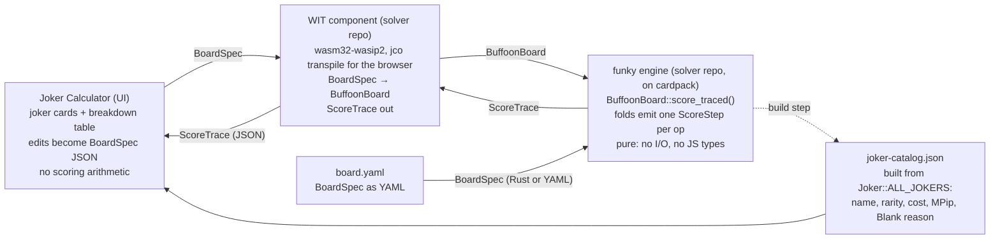

# EPIC-05: Balatro Joker Calculator integration

Oct 18, 2026 · @Christoph · *Updated 2026-10-18: facts reconciled against the code; Milestone 0 added. Updated again the same day: decisions 0f–0h made, and the engine moves to its own repo ([EPIC-06](https://github.com/ImperialBower/cardpack.rs/blob/main/docs/EPIC-06_Funky_Extraction.md)). Moved here from cardpack.rs on 2026-10-19; its history before that is in cardpack's git log.*

## Summary

The Joker Calculator stops carrying its own scoring math and becomes a thin display over the funky engine. Every number in the breakdown table comes from `BuffoonBoard`. Every joker card is a real `BuffoonCard` from `funky::decks::joker`. The "updatable" fields edit the card's `MPip` before the board re-scores.

This is the first consumer of the solver seam that EPIC-01 Story 8 built for exactly this purpose. The engine does not yet expose the one thing the calculator is for: a step-by-step trace of how chips and mult moved. So the keystone story adds a `ScoreTrace` to the fold pipeline. Everything else is packaging: a WIT component boundary, a board you can write as YAML, a shape the Design artifact can render, and a joker catalog with display names.

**Where the work happens.** On 2026-10-18 the engine was split out of cardpack into this repo, `buffoonery` (cardpack's [EPIC-06](https://github.com/ImperialBower/cardpack.rs/blob/main/docs/EPIC-06_Funky_Extraction.md)), which becomes the foundation of the solver: a WIT boundary, configuration from YAML or from Rust, and cardpack as a dependency. Milestone 0 ran in cardpack. Everything from Milestone A on runs here. This document moved here from cardpack on 2026-10-19; cardpack keeps a pointer at the old path.

The design bundle (Design artifact pages, architecture diagram) lives in [`docs/design/balatro-joker-calculator/`](design/balatro-joker-calculator/README.md). The calculator front end is not in this repo.

## Status

As of 2026-10-19. Milestone 0 code landed in cardpack `c762538`. Milestone A runs in `buffoonery`.

| Component | Status |
| --- | --- |
| Milestone 0 — prerequisites landed in cardpack (clippy, public joker list, `ScoreOp` serde, strict card parsing, serde round-trip tests) | **Complete** (`c762538`) |
| Milestone 0 — decisions 0f–0h (`Score` type, fold split, engine placement) | **Complete** (decided 2026-10-18) |
| Milestone 0 — 0i–0k | Re-homed (see Milestone 0) |
| Engine standing in its own repo (EPIC-06 Phase 1) | **Complete** (`buffoonery` 0.0.1, 2026-10-18) |
| Story S1 — fractional `Score` | **Complete** (`buffoonery` `bf779a4`, 2026-10-19) |
| Story S2 — scoring folds out of `board.rs` | **Complete** (`buffoonery` `6fa2c8d`, 2026-10-19) |
| Story 1 — `ScoreTrace` | **Complete** (`buffoonery` `622fd9e`, 2026-10-19) |
| Story 2 — joker catalog | **Complete** (`buffoonery` `00e088e`, 2026-10-19) |
| Story 3 — `BoardSpec` (Rust and YAML) | **Complete** (`buffoonery` `00e088e`, 2026-10-19). Milestone A is met |
| Story 4 — WIT component | Built (2026-10-19; 20 component tests green through `jco`), not yet committed. Its browser test moved to Story 8 |
| Story 5 — golden fixtures | Built (2026-10-19; 14 fixtures, `tests/golden.rs` green), not yet committed |
| Story 6 — the page calls the engine | Built (2026-10-19; `web/`, 9 model tests green, checked in Chrome), not yet committed |
| Stories 7–8 — hand editor, parity test | Planned |
| Milestone D — polish | Planned |

## Current state

The two sides already agree on the model: chips × mult, then base hand, played cards, held cards, and jokers left to right. Only one side is correct, and it is not the calculator.

|  | cardpack.rs `funky` (v0.11.1, `--features funky`) | Joker Calculator (Design artifact, today) |
| --- | --- | --- |
| Joker model | **112** `BuffoonCard` consts, all listed in `Joker::ALL_JOKERS` (`src/funky/decks/joker.rs:166`). The effect is data (`enhancement: MPip`, 142 variants, `src/funky/types/mpip.rs`). 8 jokers stay `Blank` with a reason in `Joker::BLANK_WITH_REASON` (`joker.rs:306`). Some non-`Blank` jokers still score 0 because they are run-state jokers, e.g. Supernova (`MultPlusOnHandPlays`) and Loyalty Card (`MultTimesEveryXHands`), listed as non-scoring at `joker.rs:2675,2677` | 28 hand-typed presets. Each is reduced to one of `+Chips` / `+Mult` / `×Mult` and a number |
| Scoring | `BuffoonBoard::score()` (`src/funky/types/board.rs:914`) runs four phases through `fold_played_cards` (`:342`), `fold_held_cards` (`:478`) and `fold_jokers` (`:556`). **One item can apply several `ScoreOp`s.** A played card applies 3 per pass: built-in, then special (Lucky / Glass / Custom), then edition (`:359-392`). Retriggers repeat all 3 (`:356`). A held card applies one op `1 + retriggers` times (`:485-494`). A joker applies 2: its effect, then its edition (`:564-584`) | JS in the artboard: base → card chips → jokers. No held-card phase, no editions, no retriggers |
| Conditions | Evaluated from the board. `builtin_joker_op` (`board.rs:591`), `joker_x_mult` (`:776`) and `counter_joker_op` (`:3096`) read `played`, `in_hand`, `jokers`, `deck`, money, discards and blind | An "active" checkbox the user ticks by hand |
| Randomness | `score()` is the deterministic floor: with no RNG, Lucky and Misprint resolve to `ScoreOp::Nothing` (`board.rs:366,568`). `score_with_seed(u64)` (`:931`) rolls them **inside** op resolution | Not modelled |
| Mult arithmetic | `Score { chips: usize, mult: usize }` (`src/funky/types/score.rs:8`). `multi_mult(f32)` **ceils** to `usize` (`score.rs:43-47`). `Score::score()` is a plain `chips * mult` (`score.rs:53`) with no overflow handling, and `usize` is **32 bits on wasm32** | Fractional mult kept (`×1.25` shows as 1.25) |
| Step-by-step trace | **None.** The folds return only the final `Score` | The whole point of the UI: a row per source with running chips, mult and score |
| Serde | `Score`, `MPip`, `BuffoonCard`, `BuffoonPile`, `Edition`, `HandType` derive serde. `ScoreOp` does too since Milestone 0 (`src/funky/types/effect.rs:25`). The JSON of `ScoreOp`, `HandType` and `Edition` is pinned by format tests | — |
| Card parsing | `BuffoonCard::from_str` rejects unknown indexes since Milestone 0 (`src/funky/types/buffoon_card.rs:373`). `"__"` is the explicit blank card (`:372`) | — |
| wasm | Compiles on `wasm32-unknown-unknown` for every feature combo ([docs/wasm.md](https://github.com/ImperialBower/cardpack.rs/blob/main/docs/wasm.md); CI `.github/workflows/CI.yaml:121`). CI's wasm **test** job runs only `--features full --test wasm` (`CI.yaml:147`), so funky never runs on wasm. `wasm-bindgen-test` is already a dev-dependency. No bindings crate yet | Browser-only. No way to call Rust |
| Display names | **No joker names anywhere.** Jokers are known by const name and `Pip` index/symbol. There is no `fn name()` on `BuffoonCard`, and no `.ftl` file under `src/localization/` names a joker | Hard-coded English names |

This table is a snapshot of cardpack at `c762538`, when the EPIC was written; its paths are cardpack paths. In `buffoonery` the files lose the `funky/` level (`src/funky/types/score.rs` → `src/types/score.rs`), and after Story S2 the scoring code lives in `src/types/board/scoring.rs`. Story 1 below cites the current `buffoonery` locations.

Sources (cardpack): `src/funky/types/{board,score,effect,mpip,buffoon_card}.rs`, `src/funky/decks/joker.rs`, [`docs/EPIC-01_Funky.md`](https://github.com/ImperialBower/cardpack.rs/blob/main/docs/EPIC-01_Funky.md) (Story 8 "solver enablement"), [`docs/EPIC-01a_Joker_Wiring_Backlog.md`](https://github.com/ImperialBower/cardpack.rs/blob/main/docs/EPIC-01a_Joker_Wiring_Backlog.md), [`.okf/architecture/funky-engine.md`](https://github.com/ImperialBower/cardpack.rs/blob/main/.okf/architecture/funky-engine.md).

## Goals and non-goals

**Goals**

- **One source of truth**: a number shown in the calculator is a number `funky` produced. The JS keeps no scoring arithmetic.
- **Every breakdown row is explainable**: it names the card, the part that fired (effect, special, or edition), the `ScoreOp` it produced, and the running `Score` after it.
- **Editable effects stay inside the type system**: a user edit becomes a `BuffoonCard` with a changed `enhancement` (or `edition`), not an override applied after the fact.
- **Conditions resolve from the board**, not a checkbox: the calculator shows *why* Jolly Joker did or did not fire because the kernel reports it.
- **The engine core stays pure**: no DOM, no JS types, no file I/O in the scoring types. WIT bindings and YAML loading are delivery adapters in the domain-kernel sense: their own modules (or features) in `buffoonery`, never inside the scoring code.
- **Configurable as data**: a board, hand levels and joker overrides can be written as YAML or built in Rust, through the same serde types.
- **Parity test**: the kernel trace and the rendered table agree on every golden board.

**Non-goals**

- Playing Balatro. No shop, no antes, no run loop in the calculator. `BuffoonBoard` already has them; the calculator ignores them.
- Pixel-accurate joker art. The simplified card stays simplified.
- Modded jokers (`MPip::Custom` / `EffectRegistry`) in v1. The seam exists; wiring it into the UI is a follow-on.
- Filling the 8 `Blank` jokers. They render as "not modelled" with their stated reason.
- WIT in cardpack. The WIT boundary belongs to the solver repo. Cardpack's verdict against WIT ([`.okf/architecture/domain-kernel.md`](https://github.com/ImperialBower/cardpack.rs/blob/main/.okf/architecture/domain-kernel.md)) still holds for cardpack, which has no game state.
- New effect *behavior* from YAML. YAML sets data: any `MPip` variant and its numbers. A new kind of effect needs Rust code in an `EffectRegistry`.

## Architecture

Three layers, one direction of truth: the UI describes a board, the kernel scores it and says how, the adapter only translates.



*Figure: integration architecture: 3 layers, 1 generated file. The older [`architecture.svg`](design/balatro-joker-calculator/docs/architecture.svg) predates the repo split and the WIT choice.*

The UI never computes. It sends a `BoardSpec` and renders the `ScoreTrace` that comes back. The joker catalog is generated from `Joker::ALL_JOKERS`, the same list the joker tests guard, so the picker cannot drift from what the engine scores.

**The two new kernel types** (in `src/types/trace.rs`):

```rust
pub struct ScoreStep {
    pub phase: Phase,            // Base, Played, Held, Joker
    pub source: StepSource,      // Hand { hand_type, level }, Card { card, index }, Joker { card, index }
    pub part: StepPart,          // Effect, Special, Edition
    pub retrigger: usize,        // 0 = first pass, 1.. = each retrigger
    pub op: ScoreOp,             // what it produced (a no-op when a condition fails)
    pub fired: bool,             // !op.is_noop()
    pub rolled: bool,            // the op came from an RNG roll (Lucky, Misprint)
    pub after: Score,            // running score once applied
}

pub struct ScoreTrace {
    pub hand_type: HandType,
    pub steps: Vec<ScoreStep>,
    pub total: Score,
}
```

**Why one step per op, not one per item.** The first draft said each item resolves to one `ScoreOp`. The code does not work that way. A played card applies up to 3 ops per pass and a joker applies 2 (see Current state). Folding them into one `Seq` step would hide the edition, and the edition is a row the calculator must show. So the trace records every `apply` call. The card's `MPip` is not a separate field, because `source` already carries the `BuffoonCard`.

The folds already call `op.apply(score)` at every point that changes the score. The trace is a sink those calls push into, so `score()` becomes `score_traced().total` and no scoring logic moves. A failed condition is a step with `op: Nothing, fired: false`, which is the "skipped" row the calculator shows today.

**The boundary** (a WIT component in the solver repo; decision 0h):

```wit
package imperialbower:solver@0.1.0;

interface calculator {
    /// A BoardSpec as JSON or YAML in; a ScoreTrace as JSON out.
    score: func(spec: string) -> result<string, string>;
    /// The joker catalog as JSON.
    catalog: func() -> string;
    version: func() -> string;
}

world joker-calculator {
    export calculator;
}
```

- **Target `wasm32-wasip2`.** It supports `std`, which `funky` needs, and gets randomness from WASI, so no `getrandom_backend` setting.
- **The browser runs it through `jco transpile`**, which turns the component into an ES module.
- **Strings first, typed records later.** `MPip` has 142 variants, so a typed WIT `variant` for it is large and would break on every new effect. v1 passes `BoardSpec` and `ScoreTrace` as serialized strings. A typed `score-step` record is a later step (open question 10).
- `BoardSpec` names jokers by their const identifier (`"JOLLY_JOKER"`) plus an optional `enhancement` override as an `MPip` and an optional `edition`. Played and held cards are card indexes (`"AS"`), parsed with the strict `BuffoonCard::from_str`. Hand levels are optional, default 1.
- No `BuffoonBoard` field is exposed raw. The component and the YAML loader are the only places that know about a format.

The domain-kernel split carries over (cardpack's `audit-2026-07-18-domain-kernel.md`): the scoring core is pure, and the adapters own the formats.

## Stories

Ordered so each milestone ships something usable on its own. Milestone 0 clears the ground. Story 1 is the keystone; nothing downstream can be honest without it.

### Milestone 0 — prerequisites (cardpack.rs)

Found by checking this EPIC's first draft against the code on 2026-10-18.

**Landed** (branch `epic-05`, commit `c762538`, 2026-10-18):

- [x] **0a. Clippy green on Rust 1.99.** A test in `src/basic/decks/registry.rs` tripped the new `needless_collect` lint, so `cargo clippy --all-targets -- -D warnings` failed.
- [x] **0b. Public joker list.** `Joker::ALL_JOKERS` / `ALL_JOKERS_SIZE` (`src/funky/decks/joker.rs:166`), `Joker::pile_all()` (`:282`), `Joker::BLANK_WITH_REASON` (`:306`) and `Joker::blank_reason()` (`:355`) moved out of `#[cfg(test)]`. Tests: `pile_all__holds_every_joker_exactly_once`, `blank_reason__explains_a_blank_joker`, `blank_reason__is_none_for_a_wired_joker`.
- [x] **0c. `ScoreOp` derives serde** (`src/funky/types/effect.rs:25`). Tests: `score_op__serde_round_trip`, `score_op__serde_format` (pins the JSON).
- [x] **0d. Strict card parsing.** `BuffoonCard::from_str` returned a blank card for *any* unknown index, so a typo in a test or fixture added a fake blank card to the hand. Unknown indexes are now `CardError::InvalidIndex` (`src/funky/types/buffoon_card.rs:373`); `"__"` is still the blank card. `BuffoonPile::forgiving_from_str` (`src/funky/types/buffoon_pile.rs:342`) now logs a warning, like `Pile::forgiving_from_str`. A probe that made `bcards!` strict found no typo in the existing 158 call sites. Test: `from_str__unknown_index_is_an_error`.
- [x] **0e. Serde round-trip tests** for every joker, `BuffoonPile`, `HandType` and `Edition`, plus format tests that pin the JSON of `HandType` and `Edition`. These pin the shape `BoardSpec` and `ScoreTrace` will carry.

**Decided** (2026-10-18):

- [x] **0f. `Score` type: fractional mult.** Balatro keeps decimals, and the change also removes the 32-bit `usize` overflow on wasm32. Built as Story S1, in `buffoonery`.
- [x] **0g. Move the scoring folds out of `board.rs` before the trace.** Built as Story S2, in `buffoonery`.
- [x] **0h. Engine placement: its own repo.** The engine moves out of cardpack and becomes the solver foundation, with a WIT boundary and YAML or Rust configuration, on top of cardpack. Cardpack deprecates and then removes its `funky` feature. Plan: [EPIC-06](https://github.com/ImperialBower/cardpack.rs/blob/main/docs/EPIC-06_Funky_Extraction.md).

**Re-homed:**

- [ ] **0i. Fix the half-stale comment at `board.rs:534-536`** (now `src/types/board/scoring.rs:275-277`). It says `MultTimesOnEmptyJokerSlots` (Joker Stencil) and `MultTimesEveryXHands` (Loyalty Card) are not applied. Stencil is applied now; Loyalty Card still is not.
- [x] **0j. Backfill `CHANGELOG.md` for 0.11.1.** Stays in cardpack; done there as EPIC-06 item 0d.
- ~~**0k. Run funky on wasm in CI (cardpack).**~~ Dropped: funky leaves cardpack. The new repo's CI builds and tests the `wasm32-wasip2` component instead (Story 4).

### Milestone A — the engine can explain itself (solver repo)

Started 2026-10-19, after EPIC-06 Phase 1 went green: the engine builds and passes its tests here.

**Story S1: fractional `Score`** (decision 0f)

- [x] `Score { chips, mult }` with a fractional `mult` (`f64`) and chips wide enough not to overflow on wasm32. `multi_mult` stops ceiling (`score.rs:43-47`); `score()` stops being an unchecked `usize` multiply (`score.rs:53`). Done: `{ chips: u64, mult: f64 }`, saturating chip adds, `score() -> f64` floored once (Balatro floors the hand score). `Score::from_usize` converts the engine's `usize` counts in one place. The engine's x-mult math moved from `f32` to `f64`, and `round_score` is `f64`
- [x] `Score` derives `Eq`, `Hash` and `Ord` today (`score.rs:5-7`). Floats cannot derive them. Decide per trait: drop it, or implement it by hand with `total_cmp`. Done: all three dropped (nothing needed them; the derived `Ord` sorted by chips first, which never meant "higher score"). `BuffoonBoard` dropped `Eq` too
- [x] Update the pinned `ScoreOp` JSON format test (`effect.rs`, `score_op__serde_format`): `Add(Score)` changes shape on purpose. Done: `{"chips":5,"mult":3.0}`
- [x] Re-baseline every test that asserted a ceiled value, and say in the commit which numbers moved and why. `buffoon` scores 11254 today; record its new value. Done: 11 tests moved (Hologram 2→1.25, Baseball 2→1.5, Ramen 2→1.01, Constellation 8→7.5, Vampire 2→1.2 twice and 8→7.5, Ancient Joker 17→16.875, Smeared + Ancient 26→25.3125, Steel Joker 15→14.4, held Steel 2→1.5, joker Polychrome 8→7.5). `buffoon` still scores **11254**; `funky_tour` output is unchanged. Decision record: [`.okf/decisions/fractional-score.md`](../.okf/decisions/fractional-score.md)
- [ ] Follow-up, not in S1: `blind_target` is still `usize`, so blind targets past 4.29 × 10⁹ would overflow on wasm32

**Story S2: scoring folds out of `board.rs`** (decision 0g)

- [x] Move `fold_played_cards`, `fold_held_cards`, `fold_jokers` and their helpers (`board.rs:289-1001` area) into `src/types/board/scoring.rs` (or similar). No behavior change. Done: `src/types/board/scoring.rs` holds phases 1–4, the three folds, the `score*` entry points, `joker_x_mult`, `counter_joker_op`, `gain_x_mult` and `LUCKY_MULT`, moved word for word (`board.rs` 8398 → 7577 lines). Four helpers the rest of `board.rs` also calls became `pub(super)`
- [x] Green check: the full suite passes with the same counts before and after. Done: the same 485 tests by name (`cargo test --lib -- --list`, diffed), `buffoon` and `funky_tour` output byte-identical, `make ayce` green


**Story 1: `ScoreTrace` in the fold pipeline**

- [x] Add `src/types/trace.rs` with `ScoreStep`, `ScoreTrace`, `Phase`, `StepSource`, `StepPart` (all `Clone + Debug + Serialize + Deserialize`, consistent with the rest of `src/types`). Done; all five are in the prelude. `StepSource` is `Hand { hand_type, level }`, `Card { card, index }` or `Joker { card, index }`; `retrigger` is a `usize`, not the sketch's `u8`, to match the engine's counts
- [x] Thread an `Option<&mut ScoreTrace>` sink through `fold_played_cards`, `fold_held_cards` and `fold_jokers`. It is a new parameter: `fold_held_cards` takes no RNG today (`scoring.rs:219`), so there is no existing parameter to copy on all three. Done: the sink is `Option<&mut Vec<ScoreStep>>`, and every `apply` goes through one helper, `trace::apply_step`, which applies the op exactly as before and records the step only when there is a sink
- [x] Push one step at every `apply` call: 3 per played-card pass (`scoring.rs:100,127,133`, inside the retrigger loop at `:97`), one per held-card application (`:233`), 2 per joker (`:319,324`). Phase 1 pushes one `Base` step carrying the `HandType` and level. Done. The base step's op is `Add(base)` applied to an empty `Score`, so a replay starts from zero
- [x] Mark RNG-resolved ops (Lucky `scoring.rs:107`, Misprint `:308`) with `rolled: true`. Done: only when an RNG is present; the plain `score_traced()` never rolls
- [x] `BuffoonBoard::score_traced()`, `score_traced_with_seed(u64)`, `score_traced_with_registry(&EffectRegistry)`: the same trio as today's `score*` (`scoring.rs:655,672,729`). No current entry point takes both an RNG and a registry; this story does not add one. Done, plus `score_traced_with_rng` to mirror `score_with_rng`. `score()` itself stays untraced, so the solver path allocates nothing; the invariant tests keep the two equal
- [x] Invariant test: for every golden board, `score_traced().total == score()` and `steps.last().after == total`. Done on 8 test boards (`golden_boards()` in `scoring.rs`'s tests), also for 8 seeds each against `score_with_seed`, and for a registry board against `score_with_registry`. Story 5 replaces these boards with shared fixtures
- [x] Invariant test: folding the steps' ops from the base `Score` reproduces each `after`. Done (`assert_replays`, from an empty `Score`)
- [x] `examples/buffoon.rs` prints the trace instead of (or alongside) the four phase totals. Done: alongside; 25 steps, 11 fired, ending at 331 × 34 = 11254
- [x] Added for the acceptance rows: `ScoreOp` implements `Display` (`+4 Mult`, `+80 Chips`, `×3 Mult`) and `ScoreOp::is_noop()`. `fired` is `!op.is_noop()`, not `op != Nothing` as sketched: a joker whose condition fails returns `Add(0 chips, 0 mult)`, not `Nothing`

*Acceptance:* a Flush with Joker + Droll Joker + Crafty Joker + Cavendish yields a trace whose joker effect rows read `+4 Mult`, `+10 Mult`, `+80 Chips`, `×3 Mult` in that order. A Pair with Droll Joker yields a `fired: false` row for it. **Met** by `score_traced__flush_joker_rows_in_order` and `score_traced__a_failed_condition_is_a_row_that_did_not_fire`.

**Story 2: joker catalog with display names**

- [x] All jokers in a stable order: `Joker::ALL_JOKERS` / `Joker::pile_all()` (Milestone 0b)
- [x] Blank reasons: `Joker::blank_reason()` (Milestone 0b)
- [x] Test: every joker appears exactly once (`pile_all__holds_every_joker_exactly_once`), and every `Blank` joker carries a non-empty reason (`all_jokers__every_blank_joker_has_a_stated_reason`, pre-existing)
- [x] A `JokerInfo { ident, name, rarity, cost, enhancement, blank_reason }` accessor over `Joker::ALL_JOKERS`. Done in `src/decks/joker_catalog.rs`: `Joker::catalog()`, `Joker::info(&card)`, `Joker::name(&card)`. `cost` is `rank.value`, the price the shop charges. `JokerInfo` is `Serialize` only (its strings are `'static`); its JSON is pinned by `joker_info__serde_format`
- [x] **A name for each of the 112 jokers.** No `.ftl` file has joker names, so this is a full table, not an override table. Decide where it lives: a `.ftl` (behind `i18n`) or a plain `const` table in `funky` (no feature cost). Done: a plain `const` table (`buffoonery` has no i18n feature). Its length is `ALL_JOKERS_SIZE`, so a missing joker does not compile, and `catalog__covers_every_joker_in_order` checks the order. Unusual spellings are pinned by `name__special_spellings` (`8 Ball`, `DNA`, `Oops! All 6s`, `Séance`, `Riff-raff`, `Canio`, …); Riff-raff, Séance and Canio were checked against published joker lists on 2026-10-19
- [x] `ident` (`"JOLLY_JOKER"`) needs a const-name ↔ card map. There is none today; build it next to `ALL_JOKERS` and test it covers all 112. Done: `Joker::by_ident("JOLLY_JOKER")` and `Joker::ident(&card)`. Each ident comes from the const by `stringify!`, so it cannot drift from its card. Lookup by card goes through the rank pip (unique per joker, tested), so an edited joker (edition, effect override, debuff) keeps its name and ident; Story 3's `JokerSpec` overrides rely on this

**Story 3: `BoardSpec`, a serde-friendly way to build a `BuffoonBoard`**

- [x] `BoardSpec { hand_levels, played, held, jokers: Vec<JokerSpec>, money, discards_left, hands_left, blind }` with every field optional and defaulted. Done in `src/types/board_spec.rs`. `played`/`held` are `CardSpec`s: a plain index (`"AS"`) or `{card, enhancement, edition}`. Unknown fields are errors. `hand_levels` needed a new `PokerHands::set_level`
- [x] `JokerSpec { ident, enhancement: Option<MPip>, edition: Option<Edition>, debuffed: bool }`: the override is the "updatable effect". Done; an overridden joker keeps its name (Story 2 looks jokers up by rank pip)
- [x] `TryFrom<BoardSpec> for BuffoonBoard` with a typed error naming the bad field (unknown ident, unknown card index, 6 jokers in 5 slots, more than 5 played cards). Done (also `TryFrom<&BoardSpec>`): `BoardSpecError` has `UnknownJoker`, `UnknownCard`, `TooManyPlayed`, `TooManyJokers` (Negative jokers take no slot), `BadHandLevel` and `Parse`; messages read like `jokers[1]: unknown joker ident "NOT_A_JOKER"`
- [x] Round-trip test: `BoardSpec` → board → trace → JSON → parse, for the golden boards. Done for the `buffoon` board (`round_trip__spec_board_trace_json`); Story 5's shared fixtures extend it to every golden board
- [x] Load a `BoardSpec` from YAML, through the same serde types. Reuse cardpack's YAML stack (`serde_norway`, the `yaml` feature) rather than adding a second YAML crate. Done: `BoardSpec::from_yaml` / `to_yaml` behind a default-on `yaml` feature, `serde_norway` 0.9.42 as cardpack uses. `CardSpec` deserializes by hand, because `#[serde(untagged)]` cannot carry YAML tags; see `.okf/decisions/board-spec-yaml.md`. The YAML `buffoon` board gives the same trace as the board built in Rust (`yaml__the_buffoon_board_matches_rust`), which is the Definition of done's YAML-vs-Rust check
- [x] Pin the YAML shape of `MPip` with format tests, like the JSON ones from Milestone 0e: once boards are written as YAML, that shape is a public contract. Done: `yaml__mpip_and_edition_format` (`!MultPlus 4`, `!Lucky` with a list, `Blank`, `Polychrome`)

*Milestone A done when:* `cargo test` is green in the solver repo and `cargo run --example buffoon` prints a trace. **Met 2026-10-19:** 539 lib tests green, and `buffoon` prints its trace with joker names.

### Milestone B — the boundary (WIT component, solver repo)

**Story 4: WIT component**

- [x] `wit/` holds the interface from the Design sketch; build with `cargo component` or `wit-bindgen`, target `wasm32-wasip2`. Done: a new workspace crate, `component/` (`buffoonery-component`, `publish = false`), with `component/wit/world.wit` exactly as sketched. `wit-bindgen` 0.63; plain `cargo build --target wasm32-wasip2` makes the component, so `cargo component` is not needed. The engine crate has no WIT or JSON code; it gained only `buffoonery::VERSION`. A `component` cargo profile (`opt-level = "z"`, LTO, `panic = "abort"`) leaves the engine's release build alone
- [x] Exports: `score(spec) -> result<string, string>`, `catalog() -> string`, `version() -> string`. Done. `score` reads JSON when the input starts with `{`, YAML otherwise; its error is the `BoardSpecError` message (`jokers[0]: unknown joker ident "NOPE"`). `version` is the engine's version. The three are plain Rust functions; the bindings (only on `wasm32`) call them
- [x] Run the golden boards against the built component in CI (for example with `wasmtime`), not only as native Rust tests. Done with Node instead of `wasmtime`: `component/js/golden.test.mjs` runs every fixture through the `jco`-transpiled component, the same ES module a browser loads (installed `wasmtime` 24 cannot invoke component exports). New CI job `component`; `make component`, part of `make ayce`. The native twin is `component/tests/golden.rs` (YAML and JSON input)
- [x] `jco transpile` produces an ES module, and a headless browser test loads it and scores one golden board. Done for the module: `jco transpile` produces it and Node tests it. **The headless browser test moved to Story 8** (decided 2026-10-19): it needs a page that loads the module (an import map for `@bytecodealliance/preview2-shim`), and that page is Milestone C's web host (open question 3). A test page built now would be thrown away
- [x] Size budget recorded in the README after `wasm-opt -Oz`; `i18n` and `colored-display` off in cardpack. Done: 571 KiB raw / 170 KiB gzip, and 467 KiB / 166 KiB after `jco opt -Oz` (which runs `wasm-opt` on the core modules; plain `wasm-opt` cannot read a component). Budget 500 KiB, checked by a test. cardpack's default features are empty, so `i18n` and `colored-display` were already off. Figures in [`component/README.md`](../component/README.md)

**Story 5: golden fixtures shared across the boundary**

- [x] `fixtures/golden/`: 10–15 `BoardSpec` (YAML) + expected `ScoreTrace` (JSON) pairs, checked into the solver repo and consumed verbatim by the Rust tests, the component tests and the UI tests. Done: 14 pairs, read by `tests/golden.rs`, which compares each trace to its JSON as a `serde_json::Value`, reads the JSON back into the same `ScoreTrace`, and checks `trace.total == score()`. `BLESS=1 cargo test --test golden` rewrites the JSON after a deliberate change ([`fixtures/golden/README.md`](../fixtures/golden/README.md)). Every total was checked by hand against Balatro's rules before it was committed. The component and UI tests (Stories 4 and 8) still have to read them
- [x] At least one fixture per `ScoreOp` variant, one with a failed condition, one with a retrigger, one with an edition, one with a `Blank` joker. Done, and enforced by `golden__coverage`: `Nothing`, `AddChips`, `AddMult`, `Add`, `TimesMult`; a failed joker condition; played and held retriggers (Hack, Hanging Chad + Sock and Buskin stacked, Mime); editions firing on a card and on jokers; DNA (`Blank`). **Not covered: `Seq`.** Only a registered custom effect returns it, and a `BoardSpec` cannot carry a registry. No fixture plays a kicker (risk 7)

### Milestone C — the calculator renders the engine (Design artifact / web)

**Story 6: replace the JS math with the wasm call**

Built 2026-10-19 in `web/` (open question 3), with Vite: `make web` tests the model and builds `web/dist`; `make dev` serves it with live reload. `web/src/model.js` turns page state into a `BoardSpec` and the trace into what the page shows; `web/src/main.js` only draws. The page's one sum is `floor(chips × mult)` for the running score, the same expression as `Score::score()`.

- [x] Load the `jco`-transpiled component. On any edit, build a `BoardSpec` from UI state and call `score`. Done; a bad spec shows the engine's error message in a banner
- [x] Delete `HANDS`, `JOKERS` and the step loop from the artboard. The breakdown table maps 1:1 onto `ScoreTrace.steps`. Done in the page, which has none of the three; the artboard stays as the design reference. One row per step; rows that changed nothing are hidden, except a joker's effect row (so "did not fire" stays visible), and "Show every step" shows them all. Until Story 7 the hand-type menu picks a sample hand (cards only; the engine finds the type and its base). No Royal Flush entry: the engine scores one as a Straight Flush, as Balatro does
- [x] Joker picker populated from `catalog()`. The card's note shows the real `MPip` and, for `Blank`, the reason. Done; the picker lists all 112 by name
- [x] The "active" checkbox becomes read-only `fired` state computed by the kernel. A manual override remains only as the `debuffed` flag. Done: the band reads "fired ✓", "did not fire" or "debuffed". **Engine change:** `debuffed` was never read in scoring, so a debuffed joker still scored. Now a debuffed joker's effect and edition are no-op steps, and it adds no retriggers, rule changes (Four Fingers, Shortcut, Smeared, Pareidolia) or odds (Oops! All 6s). Out-of-scoring readers (boss disabling, draws, rerolls) still ignore the flag
- [x] Editing the value or effect type writes a `JokerSpec.enhancement` override and shows an "overridden" badge on the card. Done. An override is unconditional: `+ Chips` → `Chips(n)`, `+ Mult` → `MultPlus(n)`, `× Mult` → `MultTimes(n)`, or `MultTimes1Dot` (tenths) for a fraction, so ×1.25 rounds to ×1.3. The note shows the override and the printed effect. **Engine change:** a joker with `Chips(n)` scored nothing; it now adds n chips (no Balatro joker carries `Chips`, so no score moved)

**Story 7: played and held cards**

- [ ] A hand editor (rank + suit per card, up to 5 played, up to 8 held) replaces the single "played card chips" number
- [ ] Hand type comes from the trace, not a dropdown. The dropdown becomes a hand-level editor per `HandType`
- [ ] Group trace rows by card (one card can make 3 steps per pass, times its retriggers)

**Story 8: parity test**

- [ ] A headless browser test loads the `jco`-transpiled component and scores one golden board (moved here from Story 4 on 2026-10-19)
- [ ] A browser test renders each golden fixture and asserts the table's cells equal the fixture's trace

### Milestone D — polish

- [ ] Seeded mode: a seed field switches to `score_traced_with_seed`. The trace marks rolled steps
- [ ] Edition picker (Foil / Holo / Poly) per joker, rendered as a corner mark on the simplified card
- [ ] Export: copy the current `BoardSpec` JSON; paste one to restore a board
- [ ] Custom effects: a `MPip::Custom(id)` entry whose `ScoreOp` the user types, routed through an `EffectRegistry` in the adapter

## Open questions and risks

1. **`Score` precision and width.** Two problems in one type (cardpack `src/funky/types/score.rs`, before S1):
   - `mult` is `usize` and `multi_mult` ceils after each ×mult (`:43-47`). Hologram at ×1.25 on mult 4 gives 5, and two ×1.5 jokers round twice. Balatro keeps fractional mult. The calculator keeps decimals.
   - `chips * mult` is unchecked (`:53`), and `usize` is 32 bits on wasm32. Late-game Balatro scores pass 4.29 × 10⁹, so the calculator would overflow in the browser.
   - Any fix is a breaking change to `Score` and to the pinned `ScoreOp` JSON (`Add(Score)`).
   - **Decided 2026-10-18 (0f):** fractional mult, built as Story S1 in `buffoonery`. Because the engine leaves cardpack, cardpack never ships this break.
   - **Built 2026-10-19:** `{ chips: u64, mult: f64 }`, floored once in `score()`. `blind_target` is still `usize` (follow-up under S1).
2. **Engine placement.** ~~A `funky-wasm` adapter crate, in cardpack's workspace or a sibling repo.~~ **Decided 2026-10-18 (0h):** the engine itself moves to its own repo, which becomes the solver foundation ([EPIC-06](https://github.com/ImperialBower/cardpack.rs/blob/main/docs/EPIC-06_Funky_Extraction.md)). This also avoids the cargo-deny trap a workspace member would have hit (cardpack [`.okf/decisions/examples-flag-free-alias.md`](https://github.com/ImperialBower/cardpack.rs/blob/main/.okf/decisions/examples-flag-free-alias.md)).
3. **Where the calculator lives.** The Design artifact cannot load a `.wasm` from the canvas page today, so Milestone C needs a real web host (a static page in the repo, `examples/wasm.rs` style). The artboard stays as the design reference.
   - **Decided 2026-10-19:** a `web/` folder in this repo, hosted on GitHub Pages. The page sits next to `component/` and `fixtures/golden/`, so the Story 8 parity test reads the fixtures directly and one CI run builds and tests both. Rejected: a separate `-web` repo (the pattern of `pkkuhn-web` and others), because it needs the component published (npm or a release file) and the fixtures copied across repos. The page can move to its own repo later, once the WIT interface has settled.
4. ~~**`funky` requires `std`**, which rules out a `no_std` component.~~ **Resolved:** the WIT component targets `wasm32-wasip2`, which supports `std`.
5. **Display names.** No joker names exist in the i18n resources (Story 2). The const name title-cased is wrong for several ("Dna", "Oops All 6s"), so a hand-checked table of all 112 is needed. **Resolved 2026-10-19:** a hand-written table in `src/decks/joker_catalog.rs` (Story 2).
6. **Trace size.** One played card makes up to 3 steps per pass. Retriggers on a 5-card hand with Hack + Sock and Buskin can produce 40+ steps. The table needs grouping by card (Story 7).
7. **Every played card scores.** The engine has no scoring-card vs kicker split (`src/types/mpip.rs:60-61`). In Balatro, a kicker in a Pair does not add chips. The calculator will show kicker rows that Balatro would not. Fix in the engine (its own story) or show it as a known gap.
8. **No Ace-low straights** (`src/types/buffoon_pile.rs:472-474`). `A-2-3-4-5` is not a straight here. The hand editor in Story 7 makes this easy to hit.
9. ~~**Crate name.**~~ **Decided 2026-10-18:** `buffoonery`, for the repo and the crate (`funky` and `buffoon` are taken on crates.io).
10. **Typed WIT records.** v1 passes `BoardSpec` and `ScoreTrace` as strings (Design). A typed `score-step` record would let non-JS hosts read the trace without a JSON parser. Worth it once the trace shape settles after Story 1; `MPip` likely stays a string.
11. **YAML is a second contract.** Once boards are written as YAML, renaming an `MPip` variant breaks users' files. Story 3 pins the shape; renames then need a version bump or a serde alias. **Pinned 2026-10-19** (`yaml__mpip_and_edition_format`).

**Risks:** scope creep toward a playable game (the board already has a shop; the calculator must keep saying no); silent drift between catalog and engine if Story 2 is hand-maintained instead of generated from `Joker::ALL_JOKERS`.

## Definition of done

- The breakdown table in the calculator is produced entirely from a `ScoreTrace` returned by the funky engine through the WIT component. The artboard contains no scoring arithmetic.
- Every one of the 112 jokers can be placed in a slot. 104 resolve to an effect; 8 show their `Blank` reason.
- Editing a joker's effect or edition changes the trace through a `JokerSpec` override, visibly marked as an override.
- Conditions are reported by the kernel (`fired`), not toggled by the user.
- A board written as YAML and the same board built in Rust produce the same trace.
- The golden fixtures pass in the solver repo's `cargo test`, against the built component, and in the browser parity test.
- This EPIC closes with a status table in the EPIC-01a style, and the solver repo's `CHANGELOG.md` lists `ScoreTrace`, `BoardSpec` and the catalog accessor under Added.

## Verification

Solver repo, from Milestone A on:

```bash
cargo fmt --check
cargo clippy --all-targets -- -Dclippy::all -Dclippy::pedantic
cargo test
cargo run --example buffoon                      # prints a trace
rustup target add wasm32-wasip2
make component                                   # builds, shrinks and transpiles the component; runs the fixtures through it
```

Milestone 0 (cardpack, `c762538`) was checked on 2026-10-18 with:

```bash
cargo fmt --check
cargo clippy -- -Dclippy::all -Dclippy::pedantic
cargo clippy --all-features --all-targets -- -Dclippy::all -Dclippy::pedantic
RUSTDOCFLAGS="-D warnings" cargo doc --no-deps --all-features
cargo test --all-features
cargo build --no-default-features
```

All passed, with 1011 lib tests under `--all-features`.
